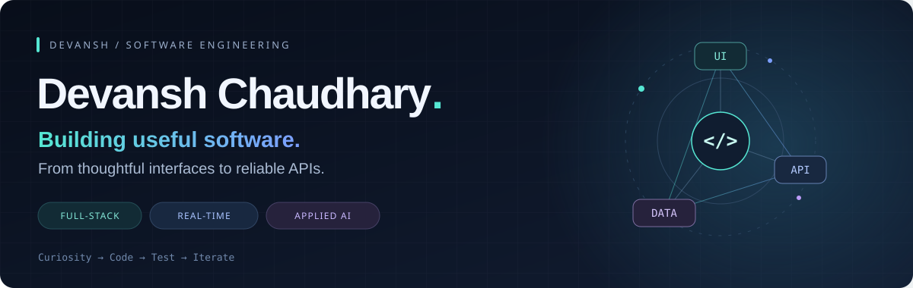
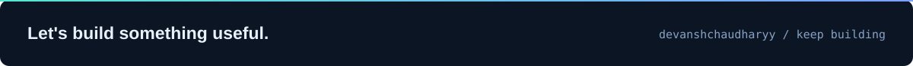

  

  
  
  
  

  

  <a href="#about">About</a> · <a href="#selected-work">Selected work</a> · <a href="#toolkit">Toolkit</a> · <a href="#github-activity">Activity</a> · <a href="#lets-connect">Connect</a>

## About

I'm **Devansh Chaudhary**, a Computer Science undergraduate at **United College of Engineering and Research, Greater Noida**. I enjoy turning practical problems into applications that connect a thoughtful frontend, a dependable backend, and useful data.

My work spans **MERN applications, real-time workflows, and experiments with local language and vision models**. I also completed a short-term research internship at the **Asian Institute of Technology, Thailand**.

- **Currently building:** ORBIT, a SaaS workspace for accounts, organizations, teams, projects, and tasks.
- **Sharpening:** data structures and algorithms, backend architecture, automated testing, and applied AI.
- **Interested in:** full-stack and backend opportunities, open-source collaboration, and useful AI applications.

> I care about the whole flow: what the user sees, what the API enforces, what the database stores, and what the tests prove.

## Selected work

<table>
  <tr>
    <td valign="top" width="50%">
      <h3>01 / SarkariSaathi AI</h3>
      
A government-scheme explorer with private profiles, official-source browsing, explainable screening, saved schemes, and preparation checklists.

      
<b>React · Node.js · Express · MongoDB</b>

      
<a href="https://github.com/devanshchaudharyy/sarkari-saathi-ai"><b>Explore repository →</b></a>

      
Implemented through Phase 5. AI/RAG is planned.

    </td>
    <td valign="top" width="50%">
      <h3>02 / RadVision AI</h3>
      
An experimental radiograph review app with authenticated uploads, account-scoped scan history, local Ollama analysis, and follow-up chat.

      
<b>Next.js · FastAPI · MongoDB · Ollama</b>

      
<a href="https://github.com/devanshchaudharyy/bone-xray-assistant"><b>Explore repository →</b></a>

      
Research prototype; requires clinician review.

    </td>
  </tr>
  <tr>
    <td valign="top" width="50%">
      <h3>03 / CitationLens</h3>
      
A document-evidence prototype that checks claims against exact quotes, preserves PDF page context, and makes insufficient evidence visible.

      
<b>React · Express · PDF.js</b>

      
<a href="https://devansh-portfolio-murex.vercel.app/#pathways"><b>View portfolio details →</b></a>

      
Local prototype.

    </td>
    <td valign="top" width="50%">
      <h3>04 / Problem solving</h3>
      
A growing collection of LeetCode solutions as I practice data structures, algorithms, and reasoning through different approaches.

      
<b>C++ · Data structures · Algorithms</b>

      
<a href="https://github.com/devanshchaudharyy/Leetcode_solutions"><b>Explore solutions →</b></a>

      
Learning through consistent practice.

    </td>
  </tr>
</table>

<b>What I'm building next: ORBIT</b>

 

**ORBIT** is my phased SaaS workspace project. Its current local implementation includes secure accounts, organizations and workspaces, team permissions, and persistent projects and tasks with assignments, checklists, labels, filtering, and activity history.

**Stack:** React, TypeScript, NestJS, and MongoDB.

My focus is connecting the interface to real API and database behavior, with automated checks for permissions, persistence, accessibility, and complete user journeys.

## Toolkit

**Languages**

  
  
  
  
  

**Frontend**

  
  
  
  
  
  

**Backend & data**

  
  
  
  
  
  

**Testing, tools & AI**

  
  
  
  
  
  

**Engineering interests:** REST APIs · Authentication & authorization · Real-time communication · Database design · Accessibility · Evidence-aware AI

## GitHub activity

  
  

  <picture>
    <source media="(prefers-color-scheme: dark)" srcset="assets/contribution-snake-dark.svg" />
    <source media="(prefers-color-scheme: light)" srcset="assets/contribution-snake.svg" />
    
  </picture>

Generated from my GitHub contribution grid · Refreshed daily · Light and dark themes

Language charts reflect repository code, including tooling; they aren't a measure of proficiency.

## Let's connect

I'm interested in **full-stack and backend roles**, thoughtful open-source work, and collaborations that turn an idea into something people can use.

**[Explore my portfolio](https://devansh-portfolio-murex.vercel.app/)** · **[Connect on LinkedIn](https://www.linkedin.com/in/devansh-singh-47b2b0326/)** · **[Send me an email](mailto:singhdevansh0506@gmail.com)**

  

